### Olá! Eu sou o Fabiano S. Sandes ✋

 
 

## Tecnologias em aprendizado 

 

 

Buscar aprender sempre

## Certificações

**Drones e aerolevantamento**
- Pilotagem de Drone/VANTs - IQUALI (2019 e 2020)
- Certificação de Aplicação Aeroagrícola Remota (CAAR) - EAAR (2026)
- Drones: conceitos, legislação e operação - SENAR (2024)
- Geofísica com Drone - Observatório Nacional (2024)
- Captação de dados por LiDAR embarcado em drone - SELPER (2025)

**Geoprocessamento e sensoriamento remoto**
- WebGIS - SENAI CIMATEC
- Técnico em Geoprocessamento - IFSULDEMINAS (2022-2023)
- Introdução ao Mapeamento 3D com Laser Scanner Terrestre - IFSULDEMINAS (2024)
- Processamento de Imagens de Satélite por Softwares Livres (PDISL) - Anhanguera (2023-2024)
- Processamento de Imagens de Satélite com Python (PDIPY) - Laboratório de Propulsão Digital (2023)
- Sistemas Sensores - Laboratório de Propulsão Digital (2022)
- Modelagem Hidrológica com o Modelo "Seasonal Water Yield"

**Inteligência artificial e dados**
- Especialização em Inteligência Artificial Aplicada a Geotecnologias - UNIAN (2025-2026)
- Visão Computacional e Deep Learning em Imagens de Satélites e Drones - Deep Field Geo (2023)
- Big Data e Estatísticas Públicas - ENCE (2024)
- Curso de Inteligência Artificial para Geotecnologias - Uniderp (2024)

## Experiência prática

- Tratamento de dados com programação auxiliada por IA
- Geonode GEOTEC / SENAI CIMATEC - criação de banco de dados (2024-2025)
- INOVA CIRCULAR - programa de computador registrado no INPI (512026007706-0, 2026)
